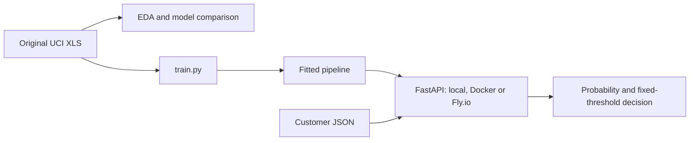

# Credit Card Default Prediction

Predict whether a credit-card client will default on the following month's
payment using the **Default of Credit Card Clients** dataset. An analyst could
use the scores to prioritize accounts for review; this project demonstrates the
modeling and serving workflow on historical Taiwan data rather than an automated
credit-approval system.

The repository includes EDA, comparison and tuning of three classifiers, a
reproducible training script, and a FastAPI service packaged with Docker and
deployed on Fly.io.

To use the hosted API, go directly to [On Fly.io](#4-on-flyio). You do not need
the dataset, training, Docker, uv or a Fly.io account. The common setup below
is for running your own local server.

**Working is guaranteed inside a GithHub Codespace, local deployment may not work**

## 1. Common setup

To run your own server on a new machine or in another Codespace, obtain this
repository, download the dataset and train the selected model first. No published
Docker image or downloadable trained model is supplied. These steps are shared
by the local Python and Docker paths. For those paths, API calls come after
starting the server.

Install Git, curl and [uv](https://docs.astral.sh/uv/getting-started/installation/).
Clone the project:

```bash
git clone https://github.com/claudcelle/credit_defaulf_prediction.git
cd credit_defaulf_prediction
ls pyproject.toml train.py examples/customer.json
uv sync --locked
```

If your Codespace was created from this repository and already contains these
files, use its repository root and skip cloning again. A Codespace created from
another repository needs its own clone of this project. Run all subsequent
commands from the directory containing `pyproject.toml`.

Download and extract the original UCI data:

```bash
mkdir -p data
curl --fail --location 'https://archive.ics.uci.edu/static/public/350/default+of+credit+card+clients.zip' --output data/uci_default.zip
uv run --locked python - <<'PYTHON'
import hashlib
from pathlib import Path
from zipfile import ZipFile

path = Path("data/default_of_credit_card_clients.xls")
if not path.exists():
    with ZipFile("data/uci_default.zip") as archive:
        content = archive.read("default of credit card clients.xls")
    with path.open("xb") as output:
        output.write(content)
expected = "30c6be3abd8dcfd3e6096c828bad8c2f011238620f5369220bd60cfc82700933"
if hashlib.sha256(path.read_bytes()).hexdigest() != expected:
    raise ValueError("Dataset checksum mismatch; verify the original UCI file.")
print("Dataset verified:", path)
PYTHON
```

Generate the model before starting either server:

```bash
uv run --locked python train.py
```

This creates both files in `models/`. Data and model artifacts are excluded from
Git, so cloning alone does not create them. You do not need to run the notebooks
before training. See [setup](docs/setup.md) for installation and notebook details.

## 2. Without Docker

**Prerequisite:** complete [Common setup](#1-common-setup), including training.
Run this entire procedure in the same machine or Codespace.

### Start

In terminal 1, from the repository root:

```bash
uv run --locked uvicorn predict:app --host 127.0.0.1 --port 8000
```

Keep this terminal running. The service uses `http://127.0.0.1:8000`.

### Call and verify

Open terminal 2 and change to the same repository root:

try 
```bash
curl --fail http://127.0.0.1:8000/health
curl --fail http://127.0.0.1:8000/predict \
  -H 'Content-Type: application/json' \
  --data-binary @examples/customer.json
python test.py --url http://127.0.0.1:8000/predict
```

otherwise
(local machine, not guaranteed)

```bash
curl --fail http://127.0.0.1:8000/health
curl --fail http://127.0.0.1:8000/predict \
  -H 'Content-Type: application/json' \
  --data-binary @examples/customer.json
uv run --locked python test.py --url http://127.0.0.1:8000/predict
```

To also compare the HTTP result with the local fitted model:

```bash
uv run --locked python test.py --url http://127.0.0.1:8000/predict --compare-local
```

Open `http://127.0.0.1:8000/docs` for interactive documentation. In Codespaces,
forward port **8000** in the **Ports** tab and open the forwarded `/docs` address.
`127.0.0.1` refers to the Codespace running the command; another Codespace needs
a reachable forwarded URL with the appropriate access permissions.

### Stop

Press **Ctrl+C in terminal 1**. See the [complete procedure without Docker](docs/api.md).

## 3. With Docker

**Prerequisite:** complete [Common setup](#1-common-setup), including training.
Install Docker and start its engine. Run this entire procedure in the same
machine or Codespace.

### Build and start

In terminal 1, from the repository root:

```bash
ls Dockerfile models/xgboost_pipeline.pkl models/xgboost_metadata.json
docker build -t credit-default:local . && \
docker run --rm --name credit-default-api -p 127.0.0.1:8001:8000 credit-default:local
```

Keep this terminal running. The container starts the API and publishes it at
`http://127.0.0.1:8001`. The `&&` runs the container only after a successful build.
The container includes the fitted pipeline and needs no dataset or mounted
volumes. The image tag is local to this Docker engine; build it in each new
Codespace where you want to run this procedure.

### Call and verify

Open terminal 2 and change to the same repository root:

```bash
curl --fail http://127.0.0.1:8001/health
curl --fail http://127.0.0.1:8001/predict \
  -H 'Content-Type: application/json' \
  --data-binary @examples/customer.json
uv run --locked python test.py --url http://127.0.0.1:8001/predict
```

To also compare the container's HTTP result with the local fitted model:

```bash
uv run --locked python test.py --url http://127.0.0.1:8001/predict --compare-local
```

Open `http://127.0.0.1:8001/docs` for interactive documentation. In Codespaces,
forward port **8001** in the **Ports** tab and open the forwarded `/docs` address.
`127.0.0.1` refers to the Codespace running the command; another Codespace needs
a reachable forwarded URL with the appropriate access permissions.

### Stop

Press **Ctrl+C in terminal 1**, or run in terminal 2:

```bash
docker stop credit-default-api
```

See the [complete Docker procedure](docs/docker.md).

## 4. On Fly.io

The hosted API is available at **https://midtermproject-default-prediction.fly.dev**.
It already runs the fitted model. Use it from a browser or a terminal without
starting a server, installing project dependencies or completing Common setup.

### Use in a browser

1. Open [health](https://midtermproject-default-prediction.fly.dev/health).
   The expected response is `{"status":"ok"}`.
2. Open the [interactive documentation](https://midtermproject-default-prediction.fly.dev/docs)
   and expand **POST /predict**.
3. Select **Try it out**, replace the request body with the complete contents of
   [examples/customer.json](examples/customer.json), then select **Execute**.
4. Check the HTTP **200** response and the prediction fields described below.

The base address `/` returns `{"detail":"Not Found"}` because there is no home
page. Use `/health` or `/docs`. The first request after inactivity may take longer
while Fly.io starts the service; wait for health to respond before running the test.

### Call and verify from a terminal

Install Git and curl; install Python only if you want to run the verification
client. If you do not already have this repository, obtain it:

```bash
git clone https://github.com/claudcelle/credit_defaulf_prediction.git
cd credit_defaulf_prediction
```

If this machine or Codespace already contains the repository, skip cloning and
change to its root instead. Run the following commands from the directory
containing `test.py` and `examples/customer.json`:

```bash
curl --fail https://midtermproject-default-prediction.fly.dev/health
curl --fail https://midtermproject-default-prediction.fly.dev/predict \
  -H 'Content-Type: application/json' \
  --data-binary @examples/customer.json
python test.py --url https://midtermproject-default-prediction.fly.dev/predict
```

The JSON contains all 23 original, unencoded integer features; see the
[field definitions](docs/data_documentation.md). Missing or incorrectly typed
fields and extra fields produce HTTP **422**.

A successful prediction returns:

| Field                   | Meaning                                                         |
| ----------------------- | --------------------------------------------------------------- |
| `default_probability` | Model score between 0 and 1 for next-month default              |
| `default`             | `true` when `default_probability` is at least `threshold` |
| `threshold`           | Fixed decision threshold, currently `0.5`                     |

The client uses only Python's standard library, `test.py` and the bundled JSON;
it needs no local model or dataset. It checks health, the prediction response and
eight invalid inputs. A successful run prints the prediction and validation
messages without an assertion error.

### Finish

Close the browser or terminal when finished. This ends your client session;
the hosted service remains available and Fly.io manages its idle stop and restart.

## Data and modeling

The [UCI dataset](https://archive.ics.uci.edu/dataset/350/default+of+credit+card+clients)
has 30,000 observations, 23 predictors, an ID and a binary next-month default
target. Financial observations cover April–September 2005. Monetary values use
New Taiwan dollars. The [data dictionary](docs/data_documentation.md) explains the
fields and undocumented codes.

[EDA](notebooks/eda.ipynb) checks types, ranges, missing values, class balance,
repeated profiles and associations with the target. There are no missing values;
22.12% of observations default. Negative statement balances, undocumented
repayment codes and repeated profiles are retained. Default rates differ across
repayment status and credit-limit groups; these are associations, not causal effects.

[Training](notebooks/training.ipynb) reserves 20% for the final test using seed 42.
All comparisons use the same five stratified folds on the other 24,000 records.
Education recoding, One-Hot Encoding and any scaling run inside each pipeline.
ID and target are excluded from predictors.

For Logistic Regression, categorical repayment codes at `C=1` give mean CV ROC-AUC
0.768255, versus 0.722513 with numerical codes. The categorical variant is tuned;
trees retain numerical repayment codes without scaling.

| Model               | Selected parameters within the tested grid      | CV ROC-AUC | CV SD (`ddof=0`) |
| ------------------- | ----------------------------------------------- | ---------: | -----------------: |
| Logistic Regression | C=0.1; categorical repayment codes              |   0.768591 |           0.006839 |
| Random Forest       | 200 trees; unlimited depth; min_samples_leaf=20 |   0.783634 |           0.005005 |
| XGBoost             | 100 trees; depth=6; learning_rate=0.05          |   0.783090 |           0.004536 |

Random Forest has the highest CV mean. XGBoost was selected before final test
inspection for its comparable CV score and smaller observed training–validation
gap (approximately 0.055 versus 0.104). This practical choice does not establish
a statistically significant advantage. The full grids and outputs are in the
training notebook.

The selected XGBoost model obtains test ROC-AUC **0.783900** on 6,000 records.
At the fixed threshold 0.5, precision is **0.672340**, recall **0.361005**, and F1
**0.469772**. Training the selected model with `train.py` does not repeat the
searches or compute test metrics.

## Reproduce and review

Use the [setup guide](docs/setup.md) to download the original XLS, install the
locked notebook environment and run EDA and training independently. See
[training and serialization](docs/training.md) for generated artifacts and loading.



| Project component                               | Location                                              |
| ----------------------------------------------- | ----------------------------------------------------- |
| EDA and model selection                         | `notebooks/eda.ipynb`, `notebooks/training.ipynb` |
| Shared model, preprocessing and paths           | `credit_default/`                                   |
| Final training and serialization                | `train.py`                                          |
| Service and HTTP verification client            | `predict.py`, `test.py`                           |
| Standalone request example                      | `examples/customer.json`                            |
| Generated data and artifacts, excluded from Git | `data/`, `models/`                                |
| Dependencies and container build                | `pyproject.toml`, `uv.lock`, `Dockerfile`       |

Evidence for the [official evaluation criteria](https://github.com/DataTalksClub/machine-learning-zoomcamp/blob/main/projects/README.md#evaluation-criteria):

| Criterion                         | Evidence                                                             |
| --------------------------------- | -------------------------------------------------------------------- |
| Problem description               | Context, intended use and limitations in this README                 |
| EDA                               | EDA notebook and data dictionary                                     |
| Multiple models and tuning        | Training notebook, shared CV and grids                               |
| Notebook-to-script export         | `train.py` and importable pipeline                                 |
| Reproducibility                   | Setup guide, public data retrieval, locked environment               |
| Model deployment                  | FastAPI `/predict`, `/health`, and HTTP client                   |
| Dependency/environment management | uv lockfile, default development group, `uv run`                   |
| Containerization                  | Dockerfile and tested build/run instructions                         |
| Cloud deployment                  | [Hosted Fly.io API and usage instructions](#4-on-flyio), `fly.toml` |

## Limitations

The historical Taiwan sample does not establish performance on present-day
customers or other populations. Repeated profiles can occur across development
and test because splitting is by row rather than by profile. Probabilities have
not been assessed for calibration. Threshold 0.5 is a fixed reference, not a
business-cost optimum; recall at that threshold is limited. Test outcomes must
not be used to retune this model or threshold.

The local and hosted services are single-observation demonstration APIs.

## Dataset attribution

Yeh, I. (2009). *Default of Credit Card Clients* [Dataset]. UCI Machine Learning
Repository. [DOI: 10.24432/C55S3H](https://doi.org/10.24432/C55S3H).
The dataset is licensed under [CC BY 4.0](https://creativecommons.org/licenses/by/4.0/).
