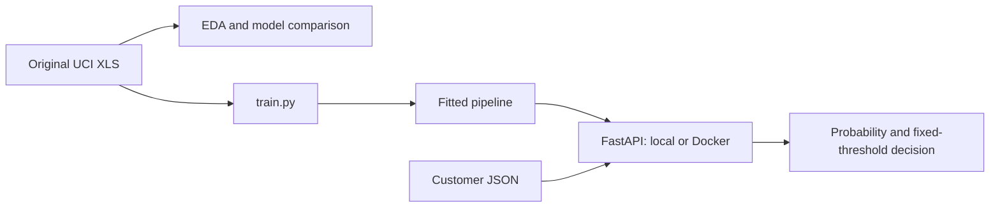

# Credit Card Default Prediction

Predict whether a credit-card client will default on the following month's
payment using the **Default of Credit Card Clients** dataset. An analyst could
use the scores to prioritize accounts for review; this project demonstrates the
modeling and serving workflow on historical Taiwan data rather than an automated
credit-approval system.

The repository includes EDA, comparison and tuning of three classifiers, a
reproducible training script, and a FastAPI service packaged with Docker.

## Choose your path

| You want to… | Start here | Requirements |
| --- | --- | --- |
| Call an already running service | [API usage](docs/api.md#call-a-running-service) | Service URL and curl, or Python standard library |
| Run the service yourself | [Local API](docs/api.md#start-your-own-server) or [Docker](docs/docker.md) | Repository, uv, dataset for training; Docker for containers |
| Reproduce the analysis and model | [Setup](docs/setup.md) and [training](docs/training.md) | Repository, uv, original UCI XLS |

No public cloud endpoint or prebuilt image is supplied. The commands below use a
service you start locally. To call another deployment, replace the base URL.

## Call the API

With a service running and this repository available:

```bash
curl --fail http://127.0.0.1:8000/health
curl --fail http://127.0.0.1:8000/predict \
  -H 'Content-Type: application/json' \
  --data-binary @examples/customer.json
```

The [complete example JSON](examples/customer.json) contains the 23 original,
unencoded features. For this example the selected model returns:

```json
{"default_probability": 0.10377471894025803, "default": false, "threshold": 0.5}
```

Open `http://127.0.0.1:8000/docs` for the interactive schema. Missing or incorrectly
typed fields and extra fields produce HTTP 422. See [API usage](docs/api.md) for
the full request, field meanings, errors, and the standalone verification client.

## Run locally

Install [uv](https://docs.astral.sh/uv/getting-started/installation/) and clone:

```bash
git clone https://github.com/claudcelle/credit_defaulf_prediction.git
cd credit_defaulf_prediction
uv sync --locked
```

Follow [download and verification](docs/setup.md#download-and-verify-the-dataset)
to obtain `data/default_of_credit_card_clients.xls`, then:

```bash
uv run --locked python train.py
uv run --locked uvicorn predict:app --host 127.0.0.1 --port 8000
```

In another terminal at the repository root:

```bash
python test.py --url http://127.0.0.1:8000/predict
uv run --locked python test.py --compare-local
```

The first command needs only Python and the bundled example; the second also
checks the saved local pipeline. Both check health, predictions and eight invalid
inputs. Stop the server with Ctrl+C. [Full local instructions](docs/api.md#start-your-own-server).

## Run with Docker

After generating the model with `train.py`, with the Docker engine running:

```bash
docker build -t credit-default:local .
docker run --rm --name credit-default-api -p 127.0.0.1:8001:8000 credit-default:local
```

From another terminal:

```bash
python test.py --url http://127.0.0.1:8001/predict
docker stop credit-default-api
```

The image includes the trained pipeline and its code. Inference requires no
dataset, notebooks, mounted volumes, or host Python environment. Building it from
a fresh checkout requires the dataset and training step first. See [Docker guide](docs/docker.md).

## Data and modeling

The [UCI dataset](https://archive.ics.uci.edu/dataset/350/default+of+credit+card+clients)
has 30,000 observations, 23 predictors, an ID and a binary next-month default
target. Financial observations cover April–September 2005. Monetary values use
New Taiwan dollars. The [data dictionary](docs/data_documentation.md) explains the
fields and undocumented codes.

[EDA](notebooks/eda.ipynb) checks types, ranges, missing values, class balance,
repeated profiles and associations with the target. There are no missing values;
22.12% of observations default. Negative statement balances, undocumented
repayment codes and repeated profiles are retained. Default rates differ across
repayment status and credit-limit groups; these are associations, not causal effects.

[Training](notebooks/training.ipynb) reserves 20% for the final test using seed 42.
All comparisons use the same five stratified folds on the other 24,000 records.
Education recoding, One-Hot Encoding and any scaling run inside each pipeline.
ID and target are excluded from predictors.

For Logistic Regression, categorical repayment codes at `C=1` give mean CV ROC-AUC
0.768255, versus 0.722513 with numerical codes. The categorical variant is tuned;
trees retain numerical repayment codes without scaling.

| Model | Selected parameters within the tested grid | CV ROC-AUC | CV SD (`ddof=0`) |
| --- | --- | ---: | ---: |
| Logistic Regression | C=0.1; categorical repayment codes | 0.768591 | 0.006839 |
| Random Forest | 200 trees; unlimited depth; min_samples_leaf=20 | 0.783634 | 0.005005 |
| XGBoost | 100 trees; depth=6; learning_rate=0.05 | 0.783090 | 0.004536 |

Random Forest has the highest CV mean. XGBoost was selected before final test
inspection for its comparable CV score and smaller observed training–validation
gap (approximately 0.055 versus 0.104). This practical choice does not establish
a statistically significant advantage. The full grids and outputs are in the
training notebook.

The selected XGBoost model obtains test ROC-AUC **0.783900** on 6,000 records.
At the fixed threshold 0.5, precision is **0.672340**, recall **0.361005**, and F1
**0.469772**. Training the selected model with `train.py` does not repeat the
searches or compute test metrics.

## Reproduce and review

Use the [setup guide](docs/setup.md) to download the original XLS, install the
locked notebook environment and run EDA and training independently. See
[training and serialization](docs/training.md) for generated artifacts and loading.



| Project component | Location |
| --- | --- |
| EDA and model selection | `notebooks/eda.ipynb`, `notebooks/training.ipynb` |
| Shared model, preprocessing and paths | `credit_default/` |
| Final training and serialization | `train.py` |
| Service and HTTP verification client | `predict.py`, `test.py` |
| Standalone request example | `examples/customer.json` |
| Generated data and artifacts, excluded from Git | `data/`, `models/` |
| Dependencies and container build | `pyproject.toml`, `uv.lock`, `Dockerfile` |

Evidence for the [official evaluation criteria](https://github.com/DataTalksClub/machine-learning-zoomcamp/blob/main/projects/README.md#evaluation-criteria):

| Criterion | Evidence |
| --- | --- |
| Problem description | Context, intended use and limitations in this README |
| EDA | EDA notebook and data dictionary |
| Multiple models and tuning | Training notebook, shared CV and grids |
| Notebook-to-script export | `train.py` and importable pipeline |
| Reproducibility | Setup guide, public data retrieval, locked environment |
| Model deployment | FastAPI `/predict`, `/health`, and HTTP client |
| Dependency/environment management | uv lockfile, default development group, `uv run` |
| Containerization | Dockerfile and tested build/run instructions |
| Cloud deployment | Deferred; no cloud deployment points claimed |

## Limitations

The historical Taiwan sample does not establish performance on present-day
customers or other populations. Repeated profiles can occur across development
and test because splitting is by row rather than by profile. Probabilities have
not been assessed for calibration. Threshold 0.5 is a fixed reference, not a
business-cost optimum; recall at that threshold is limited. Test outcomes must
not be used to retune this model or threshold.

The service is a single-observation demonstration API. Cloud hosting is outside
the current scope.

## Dataset attribution

Yeh, I. (2009). *Default of Credit Card Clients* [Dataset]. UCI Machine Learning
Repository. [DOI: 10.24432/C55S3H](https://doi.org/10.24432/C55S3H).
The dataset is licensed under [CC BY 4.0](https://creativecommons.org/licenses/by/4.0/).
